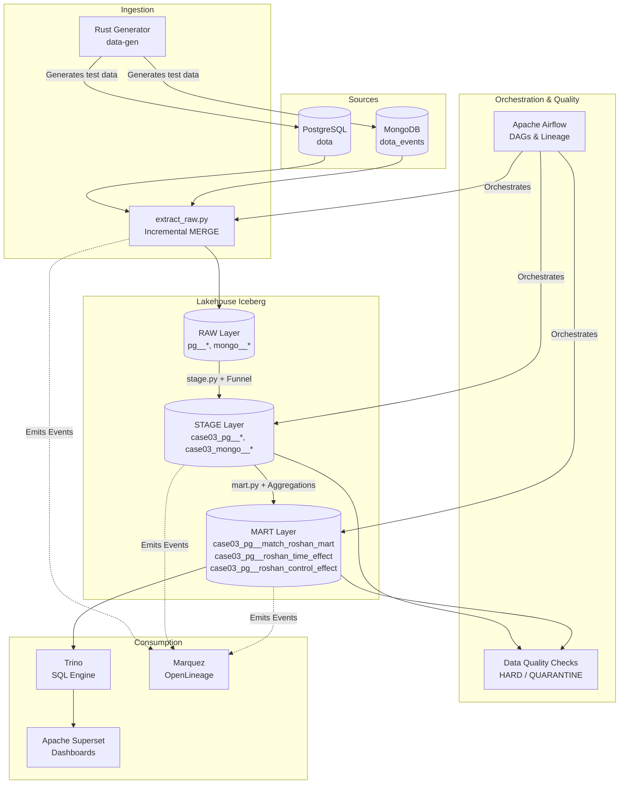

# Bootcamp 2026: Dota 2 Lakehouse & Analytics Pipeline (VERSION_2)

Production-ready Data Engineering and Analytics pipeline for Dota 2 match analysis, built on the Medallion Architecture (RAW → STAGE → MART) using Apache Spark, Iceberg, Airflow, and Trino.

## 🏗 Architecture



## 🚀 Quick Start

### Prerequisites
- Docker & Docker Compose (v2.x+)
- WSL2 (if running on Windows)
- At least 8GB RAM allocated to Docker

### 1. Environment Setup
```bash
cd bootcamp2026-notebooks/VERSION_2
cp .env.example .env
# Edit .env with your preferred passwords if needed
```

### 2. Start Infrastructure
```bash
# Start base services (PostgreSQL, MongoDB, RustFS)
docker compose --profile base up -d

# Wait for databases to be healthy (approx. 30s)
docker compose ps

# Start ETL, Compute, BI, and Lineage services
docker compose --profile etl --profile compute --profile bi --profile lineage up -d
```

### 3. Run the Pipeline
The pipeline is orchestrated by Airflow. Access the UI at `http://localhost:8081` (admin / admin).

1. Unpause the `case_03_roshan_dag`.
2. Trigger a manual run.
3. Monitor the TaskGroups: `raw_layer` → `stage_layer` → `mart_layer` → `quality_layer`.

Alternatively, run jobs manually via `spark-submit` inside the Spark container:
```bash
docker exec -it dota-spark bash
spark-submit --packages org.apache.iceberg:iceberg-spark-runtime-3.5_2.12:1.5.0 \
  /opt/spark-apps/jobs/case_3/stage.py
```

### 4. Query the Data
Access Trino at `http://localhost:8080` (user: `admin`, no password by default).
```sql
SHOW TABLES IN lakehouse.mart;
SELECT * FROM lakehouse.mart.case03_pg__match_roshan_mart LIMIT 10;
```

### 5. View Dashboards
Access Superset at `http://localhost:8088` (admin / admin).
The `init_superset.py` script automatically configures the Trino connection and registers the MART datasets upon first startup.

## 📊 Case 03: Roshan & Victory Analytics

**Business Question:** How does killing Roshan correlate with match victory, and how does this effect depend on timing, control difference, and match pace?

### Pipeline Layers

#### 1. RAW Layer (`lakehouse.raw.*`)
Incremental ingestion from PostgreSQL and MongoDB using `MERGE INTO` with watermark tracking to prevent duplicates.
- `pg__matches`, `pg__match_players`, `pg__npcs`
- `mongo__cs_events`, `mongo__gold_events`, `mongo__tower_death_events`

#### 2. STAGE Layer (`lakehouse.stage.case03_*`)
Deduplication, type casting, null checks, and referential integrity enforcement. **No business aggregations here.**
- Implements a strict **Data Funnel**, logging the exact number and percentage of rows removed at each filtering step (e.g., matches < 10 min, invalid player slots).

#### 3. MART Layer (`lakehouse.mart.case03_*`)
Business logic and analytical aggregations:
- **`case03_pg__match_roshan_mart`**: Match-level granularity. Cascading resolution of the Roshan killer's side (account_id → hero_id → gold_events), tower status strictly *before* the kill, match pace binning, and Roshan control metrics.
- **`case03_pg__roshan_time_effect`**: Aggregated win rates, Wilson 95% confidence intervals, and time quantiles grouped by first Roshan time bins.
- **`case03_pg__roshan_control_effect`**: Win rates by Roshan control status (Radiant Lead, Dire Lead, Tie) and lead magnitude, sliced by match pace.

#### 4. Data Quality (`src/jobs/case_3/dq_checks.py`)
Automated checks executed after MART generation:
- **HARD**: Fails the DAG if critical rules are violated (e.g., `total_roshan_kills != roshan_killed_by_radiant + roshan_killed_by_dire + roshan_killer_side_unknown`).
- **QUARANTINE**: Isolates invalid rows into `lakehouse.quarantine.*` tables without stopping the pipeline.

## 📚 Governance & Documentation

All governance artifacts for this version are maintained independently in `VERSION_2/governance/`:
- **[Data Dictionary (RU)](governance/01_data_dictionary-ru.md)** / **[EN](governance/01_data_dictionary-en.md)**: Comprehensive schema definitions, PII flags, and validation rules.
- **[Data Quality Spec (RU)](governance/02_data_quality_spec-ru.md)** / **[EN](governance/02_data_quality_spec-en.md)**: Detailed DQ rules (HARD/QUARANTINE) and PySpark implementation.
- **[Data Lineage Spec (RU)](governance/03_data_lineage_spec-ru.md)** / **[EN](governance/03_data_lineage_spec-en.md)**: OpenLineage integration details and dataset mapping.
- **[Incident Response & SLA (RU)](governance/04_incident_response_runbook-ru.md)** / **[EN](governance/04_incident_response_runbook-en.md)**: Service level agreements, incident classification (P1-P4), and response procedures.
- **[Access Control Matrix (RU)](governance/05_access_control_matrix-ru.md)** / **[EN](governance/05_access_control_matrix-en.md)**: RBAC policies adapted to the actual infrastructure.

## 🛠 Tech Stack
- **Orchestration**: Apache Airflow 2.11.2
- **Processing**: Apache Spark 3.5.8 (PySpark)
- **Storage**: Apache Iceberg (via RustFS S3-compatible API)
- **Query Engine**: Trino 484
- **BI**: Apache Superset 6.1.0
- **Lineage**: Marquez 0.51.1 + OpenLineage
- **Data Generation**: Rust (Tokio, SQLx, MongoDB driver)

## 📝 Notes for Reviewers
- The Rust data generator is designed to be run periodically via a dedicated Airflow DAG or manually to populate the source databases with reproducible, seeded data.
- All PySpark jobs use the `SparkSessionContextManager` from `src/common/lakehouse_spark.py` to ensure consistent OpenLineage event emission.
- The pipeline is idempotent: re-running the DAG will safely `MERGE` or `createOrReplace` tables without creating duplicates.